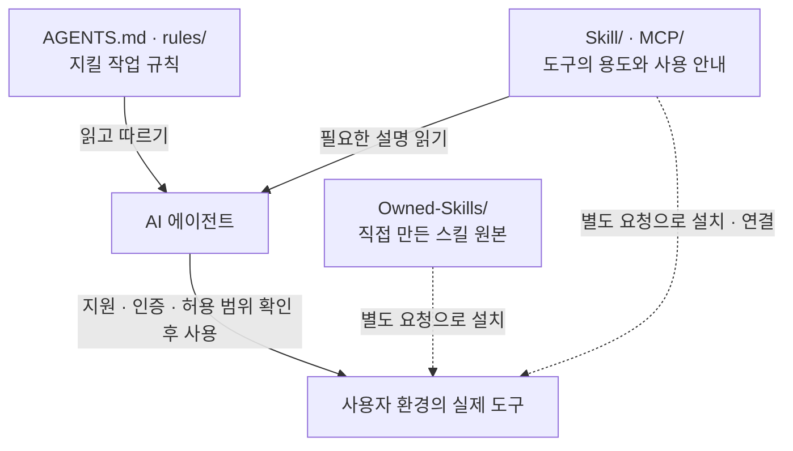
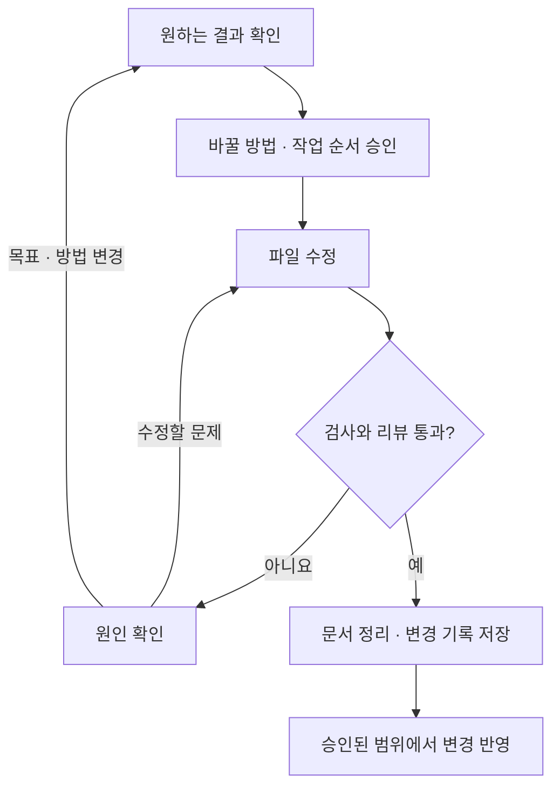

<!-- 사람용 상세 안내로 AI 작업 규칙, 적용 방법과 도구의 역할을 설명한다. -->
# Agent-Instructions 상세 사용 안내

이 문서는 [README의 시작 안내](README.md)를 읽고, **왜 이런 규칙이 필요한지와 실제로 어떻게 사용하는지** 더 알고 싶은 사람을 위한 설명서입니다. 필요한 부분만 찾아 읽어도 됩니다.

AI는 README에서 목적을 파악한 뒤 [AGENTS.md](AGENTS.md)의 핵심 규칙, [PORTABILITY.md](PORTABILITY.md)의 환경별 안내와 작업에 필요한 `rules/`를 따릅니다. 이 설명서는 정식 규칙을 이해하는 데 도움을 줍니다.

- [AI에게 무엇을 알려 주는 안내서인가요](#ai에게-무엇을-알려-주는-안내서인가요)
- [문서와 도구는 어떻게 연결되나요](#문서와-도구는-어떻게-연결되나요)
- [규칙을 적용하고 실행 환경을 준비하는 방법](#규칙을-적용하고-실행-환경을-준비하는-방법)
- [AI에게 일을 맡긴 뒤 확인하는 방법](#ai에게-일을-맡긴-뒤-확인하는-방법)
- [필요한 스킬과 MCP를 고르는 방법](#필요한-스킬과-mcp를-고르는-방법)
- [규칙을 보완하고 문서를 관리하는 방법](#규칙을-보완하고-문서를-관리하는-방법)
- [공개하기 전에 확인할 것](#공개하기-전에-확인할-것)
- [알아둘 한계](#알아둘-한계)
- [자주 묻는 질문](#자주-묻는-질문)
- [출처와 이용 조건](#출처와-이용-조건)

## AI에게 무엇을 알려 주는 안내서인가요

AI 에이전트는 대답하는 것에 더해 파일을 읽거나 고치고, 명령어를 실행하고, 연결된 서비스를 사용할 수 있는 AI입니다. Codex와 Claude Code가 그 예입니다. 가능한 작업과 권한은 사용하는 앱과 설정에 따라 다릅니다.

예를 들어 “로그인 화면의 오류를 고쳐 줘”라는 요청에서 AI가 다른 화면까지 바꾸면 원하지 않는 결과가 생길 수 있습니다. 파일을 고쳤지만 실행해 보지 않았다면 오류가 남아 있을 수도 있습니다. Agent-Instructions는 이런 일을 줄이기 위해 **요청한 범위를 확인하고, 바꾼 결과를 검사하고, 확인한 근거를 알려 주는 순서**를 정리합니다.

### 핵심 규칙은 짧게, 설명은 필요할 때

매 작업에 필요한 중요한 규칙은 `AGENTS.md`에 모읍니다. 자세한 설명은 별도 문서에 두고, 해당 상황에서 찾아 읽도록 안내합니다. 그래서 처음부터 스킬 이름이나 긴 도구 목록을 외울 필요가 없습니다.

상세 규칙은 네 가지 주제로 나뉩니다.

| 주제 | 쉽게 풀면 | 정식 문서 |
|---|---|---|
| 검증·커밋 | 결과를 확인한 뒤 완료라고 말하고 변경 기록을 저장합니다. | [rules/01](rules/01_enforcement-system.md). |
| 도구 경계 | 도구로 할 수 있는 일과 허용된 범위를 확인합니다. | [rules/02](rules/02_tool-boundaries.md). |
| 피드백 | 실패 원인과 해결 방법을 남겨 같은 실수를 줄입니다. | [rules/03](rules/03_feedback-loop.md). |
| 정리 | 코드와 설명이 맞는지, 불필요하거나 중복된 내용이 있는지 살핍니다. | [rules/04](rules/04_garbage-collection.md). |

문서는 AI가 따를 규칙입니다. 모든 규칙을 프로그램이 자동으로 막거나 검사하는 것은 아닙니다. 자동 검사 기능이 없는 환경에서는 AI가 직접 확인해야 합니다.

## 문서와 도구는 어떻게 연결되나요

**작업 규칙, 도구 설명, 실제 도구**를 구분하면 폴더 구조를 이해하기 쉽습니다.

실선은 문서를 읽거나 도구를 사용하는 관계이고, 점선은 별도로 준비하는 관계입니다. Mermaid 그림을 지원하지 않는 뷰어에서는 그림 대신 코드가 보일 수 있습니다.

### 파일을 찾을 때 보는 지도

| 위치 | 들어 있는 것 |
|---|---|
| [README.md](README.md) | 처음 보는 사람과 AI를 위한 시작 안내, 복사해서 쓰는 요청 문장과 구조도입니다. |
| [GUIDE.md](GUIDE.md) | 지금 읽는 사람용 상세 설명서입니다. |
| [AGENTS.md](AGENTS.md) | AI가 지킬 핵심 작업 규칙입니다. |
| [GETTING_STARTED.md](GETTING_STARTED.md) | 적용·설치의 구체적인 절차와 확인 방법입니다. |
| [codex-global-AGENTS.md](codex-global-AGENTS.md) | Codex의 기존 전역 지침에 병합할 기본 규칙입니다. |
| [PORTABILITY.md](PORTABILITY.md) | 사용하는 AI가 다를 때 기능을 바꿔 적용하는 방법입니다. |
| [rules/](rules/) | 검사·권한·피드백·정리의 상세 규칙입니다. |
| [Skill/](Skill/CATALOG.md) | 특정 작업을 수행하는 방법인 스킬의 설명과 원본 출처입니다. |
| [MCP/](MCP/README.md) | AI와 외부 도구를 연결하는 방법과 필요한 인증의 안내입니다. |
| [Owned-Skills/](Owned-Skills/README.md) | 이 저장소에서 직접 만든 스킬의 설치 가능한 원본입니다. |
| [references/](references/) | CLI 설치, Windows 바로가기, 추가 도구 검토 등을 돕는 참조 문서입니다. |
| [SECURITY.md](SECURITY.md) | 공개하면 안 되는 정보와 공개 전 확인 기준입니다. |
| [CHANGELOG.md](CHANGELOG.md) | 이 저장소에서 변경한 내용을 기록합니다. |
| [docs/](docs/) | 작업의 설계·계획·리뷰 기록입니다. |

## 규칙을 적용하고 실행 환경을 준비하는 방법

### 규칙을 적용할 때

이미 쓰는 AI에게 [README의 첫 번째 요청 문장](README.md#이미-쓰고-있는-ai에게-규칙을-알려-주려면)을 보내면 됩니다. “적용”은 문서를 읽고 그 규칙을 따르라는 뜻입니다. 도구 설치까지 요청하는 문장은 따로 있습니다.

링크를 읽을 수 없는 AI라면 저장소를 내려받아 파일 내용을 차례로 전달합니다. 프로젝트 폴더나 공통 위치에 문서를 두고 AI에게 실제 위치를 알려 주는 방법도 있습니다. 문서 폴더를 복사했다고 모든 AI가 그 안의 지침을 자동으로 읽는 것은 아닙니다.

읽는 순서는 다음과 같습니다.

1. `README.md`로 전체 목적과 문서 위치를 확인합니다.
2. `AGENTS.md`의 핵심 작업 규칙을 읽습니다.
3. `PORTABILITY.md`로 자신의 환경에서 지원하는 기능과 대체 방법을 확인합니다.
4. 해당 작업에 필요한 `rules/`, 스킬·MCP 설명만 추가로 읽습니다.

### Windows 실행 환경을 준비할 때

[README의 두 번째 요청 문장](README.md#windows에서-실행할-ai-도구까지-준비하려면)은 명령어 창에서 사용하는 AI 프로그램인 CLI와 기본 지침, 바탕화면 바로가기를 준비하도록 요청합니다.

기본 준비 범위는 다음과 같습니다.

| 단계 | 진행하는 일 | 완료 확인 |
|---|---|---|
| 대상 선택 | 사용자가 지정한 Codex 또는 Claude Code 하나를 선택합니다. | 선택한 도구가 명확합니다. |
| CLI 준비 | 기존 설치를 재사용하거나, 없으면 선택한 도구만 공식 절차로 설치합니다. | 실행 파일의 전체 경로와 버전을 확인합니다. |
| 지침 준비 | 기존 사용자 지침을 읽고 백업한 뒤 기본 규칙을 보존하며 추가합니다. | 새 세션에서 실제로 읽힌 지침을 확인합니다. |
| 바로가기 준비 | 실제 바탕화면에 공식 아이콘의 바로가기를 준비합니다. | 열었을 때 선택한 CLI·작업 폴더·문자 인코딩이 맞습니다. |
| 로그인 | 필요한 경우 사용자가 직접 로그인합니다. | 인증이 끝났는지 또는 대기 중인지 구분합니다. |

대상을 지정하지 않으면 현재 세션의 신뢰할 수 있는 실제 클라이언트 정보를 사용합니다. 모델 이름이나 설치된 CLI 목록으로 추정하지 않으며, 판별할 수 없으면 한 번 질문합니다. 선택 전에는 설치·설정을 변경하지 않습니다. 두 도구가 설치돼 있어도 선택한 하나만 처리합니다.

Windows Terminal이 있으면 재사용하고, 없으면 CMD를 사용합니다. 기본 준비에 Terminal 설치를 추가하지 않습니다. 공식 아이콘 준비 실패, 바로가기·CLI 실행 실패, 로그인 대기, 지침 읽기 미확인은 각각 미완료입니다.

스킬·MCP·플러그인·hooks·테마·상태줄·권한 변경·bypass 옵션은 **별도 확장 요청에서만** 다룹니다. 다른 운영체제나 지원하지 않는 도구에는 이 Windows 절차를 임의 적용하지 않습니다. 명령어와 바로가기 속성은 [Windows 최소 세팅 안내](GETTING_STARTED.md#41-windows-codex-환경-세팅) 및 [바로가기 절차](references/windows-cli-shortcut.md)를 따릅니다.

### 기존 지침과 설정 위치

전역 지침은 여러 프로젝트에서 공통으로 쓰는 작업 규칙입니다. 프로젝트 지침은 해당 프로젝트의 규칙입니다. 새 지침을 넣을 때는 기존 내용을 읽고 충돌을 확인하며 사용자 고유 규칙을 보존합니다.

| 도구 | 기본 설정 홈 | 지침을 넣는 방법 |
|---|---|---|
| Codex | `~/.codex` | 기존 `AGENTS.md`와 `codex-global-AGENTS.md`의 기본 규칙을 병합합니다. |
| Claude Code | `~/.claude` | 기존 `CLAUDE.md`를 유지하고 `@Agent-Instructions/AGENTS.md` 연결을 추가합니다. |

`~`는 사용자 홈 폴더를 뜻합니다. `CODEX_HOME` 또는 `CLAUDE_CONFIG_DIR`을 지정했다면 표의 기본 위치 대신 지정된 설정 홈을 사용합니다. 지침·복제본·아이콘도 해당 홈을 기준으로 관리합니다.

Codex에 `AGENTS.override.md`가 있으면 기본 `AGENTS.md`보다 우선할 수 있습니다. 새 규칙이 가려지면 임의로 삭제하지 말고 충돌을 확인합니다. Claude Code의 `@...` 연결은 그 연결을 적은 파일의 위치를 기준으로 해석됩니다. 실제 로드 여부는 새 세션에서 확인하며, Claude Code는 `/context`의 **Memory files**를 확인합니다. Codex의 자세한 로딩 기준은 [Codex 적용 안내](GETTING_STARTED.md#4-codex에서-헷갈리기-쉬운-부분)를 따릅니다.

### 추가 도구를 준비할 때

스킬과 MCP는 각각 별도 준비가 필요합니다.

- 스킬은 해당 AI의 지원 여부를 확인하고 원본 안내를 따릅니다. `SKILL.md` 한 파일만 떼어 오지 않고 스크립트·참조 문서 등 필요한 리소스가 포함된 패키지를 유지합니다. Codex 전역 스킬은 `~/.agents/skills`의 설치 항목을 기준으로 확인합니다.
- 직접 만든 스킬은 [Owned-Skills](Owned-Skills/README.md)의 원본을 사용합니다. 타사 스킬은 [출처·설치 안내](Skill/README.md)에서 원본과 이용 조건을 확인합니다.
- MCP는 사용 중인 클라이언트의 설정 형식과 지원하는 연결 방식을 확인합니다. Claude Code의 `claude mcp add`와 설정 경로를 다른 AI에 그대로 적용하지 않습니다.
- OAuth는 브라우저에서 계정에 로그인해 연결 권한을 허용하는 방식입니다. Notion·Figma·Hugging Face처럼 인증이 필요한 서비스는 사용자 계정으로 연결하고 비밀값을 공개 저장소에 넣지 않습니다.
- 연결이 끝나면 실제 사용 가능한 도구 목록과 권한을 확인합니다. 설명 문서에 적힌 이름만으로 현재 연결·인증·작동을 보장하지 않습니다.

구체적인 연결과 환경별 예시는 [PORTABILITY.md](PORTABILITY.md)에 있습니다.

## AI에게 일을 맡긴 뒤 확인하는 방법

“설명해 줘”나 “리뷰만 해 줘”는 조회·진단 요청입니다. “고쳐 줘”는 상태를 변경하는 요청입니다. AI는 이 차이를 구분하고 승인된 범위에서 작업합니다.

기본 작업은 세 단계로 설명할 수 있습니다.

| 단계 | AI가 할 일 | 사용자가 볼 것 |
|---|---|---|
| 의도 확인 | 원하는 결과와 현재 문제를 파악합니다. | 불명확한 점에 대한 질문과 확인한 사실입니다. |
| 바꿀 내용 정리 | 무엇을 어디서 어떻게 바꿀지, 영향과 주의사항을 설명합니다. | 승인할 수 있는 구체적인 범위와 방법입니다. |
| 실행과 확인 | 승인된 일을 수행하고 결과를 검사합니다. | 변경 내용, 검사 근거, 남은 확인 사항입니다. |

파일을 바꾸는 작업에서는 `design-driven-delivery` 스킬이 설계·계획·수정·검증·리뷰의 순서를 조율합니다. 설명이나 수정 권한이 없는 리뷰에 전체 변경 절차를 강제하지는 않습니다.

프로그램의 기능이나 오류를 고칠 때는 문제를 보여 주는 테스트를 먼저 만들고, 고친 뒤 통과하는지 확인합니다. 문서 변경은 링크·설명·문법 등 변경 종류에 맞는 검사로 확인합니다. 리뷰에서 결함을 발견하면 고친 뒤 관련 검사를 다시 실행합니다.

예상과 다른 결과가 나왔다면 실제 에러와 로그를 읽고 원인을 확인합니다. “아마 이 문제일 것”이라는 추측만으로 변경 범위를 늘리지 않습니다.

커밋은 검사한 변경을 기록하는 일이고, 푸시는 온라인 저장소로 보내는 일입니다. 다른 작업과 합치는 병합이나 검토 요청인 PR도 각각 별도의 행동입니다. 검사 없이 커밋하지 않으며, 병합·PR·푸시는 요청·승인된 범위에서 수행합니다. [상태 변경의 상세 절차](Owned-Skills/design-driven-delivery/references/change-workflow.md)를 참고하세요.

## 필요한 스킬과 MCP를 고르는 방법

스킬은 **어떻게 일할지 알려 주는 방법**, MCP는 **외부 도구를 연결하는 방식**입니다. 예를 들어 코드 리뷰 스킬은 놓친 오류를 살펴보는 방법을 안내하고, Notion MCP는 연결 권한이 있는 페이지를 읽거나 수정할 도구를 제공합니다.

### 작업에 따라 찾는 예시

아래 이름을 외울 필요는 없습니다. AI가 작업에 맞는 설명을 찾아 실제 사용 가능 여부를 확인합니다.

| 하고 싶은 일 | 먼저 살펴볼 항목 |
|---|---|
| 파일을 바꾸는 작업 전체의 순서 정하기. | `design-driven-delivery`. |
| 새 기능의 목적과 방법 정리하기. | `brainstorming`, `writing-plans`. |
| 프로그램 기능이나 오류 수정하기. | `test-driven-development`, `systematic-debugging`. |
| 결과 확인과 코드 리뷰. | `verify`, `verification-before-completion`, `code-review`. |
| 웹 자료를 찾고 조사하기. | `firecrawl-*`, `deep-research`. |
| 라이브러리의 공식 사용법 확인하기. | `context7` MCP. |
| 디자인이나 관계 그림 다루기. | Figma 관련 스킬과 MCP. |
| AI 모델·데이터·데모 앱 다루기. | Hugging Face 관련 스킬과 MCP. |
| 브라우저 동작 확인하기. | Playwright MCP나 Chrome DevTools 관련 스킬. |

스킬 설명은 **용도, 사용할 상황, 예시, 도구와 입력값, 출처와 설치 상태**를 안내합니다. [스킬 전체 목록](Skill/CATALOG.md)에서 적합한 항목을 찾고 [출처·설치 안내](Skill/README.md)를 확인합니다.

### 연결할 외부 도구의 예

| 도구 | 용도와 확인할 조건 |
|---|---|
| [Notion](MCP/notion.md) | 페이지·데이터베이스를 다룹니다. 수정할 대상과 권한을 확인합니다. |
| [Context7](MCP/context7.md) | 라이브러리 공식 문서를 확인합니다. |
| [Playwright](MCP/playwright.md) | 브라우저를 조작하며 동작을 확인합니다. 설치 버전의 도구와 입력값을 확인합니다. |
| [Figma](MCP/figma.md) | 디자인·다이어그램을 다룹니다. 연결 지원과 로그인이 필요합니다. |
| [Hugging Face](MCP/huggingface-skills.md) | 모델·데이터 등과 연결합니다. 지원 범위와 인증 상태를 확인합니다. |
| [claude.ai PlayMCP](MCP/claude-ai-PlayMCP/README.md) | 네이버·사람인·미국주식·DART·카카오의 계정 연동 도구입니다. 다른 AI에서는 대체 서버나 API가 필요합니다. |

전체 목록과 인증 안내는 [MCP 인덱스](MCP/README.md)에 있습니다. ON과 OFF 표시는 작성 당시 환경의 활성·비활성 상태이며, 지금 내 환경의 상태를 뜻하지 않습니다. 활성 플러그인이라도 스킬이나 MCP를 제공하지 않으면 그 목록에 없을 수 있습니다.

기존 도구로 해결하기 어려운 요구가 생겼을 때만 [추가 도구 검토 안내](references/starred-repo-adoption.md)를 참고합니다. 후보로 설명돼 있다고 설치하거나 활성화한 것은 아닙니다. 도구 추가 전에는 지원 환경, 필요한 권한, 외부로 전달되는 데이터와 검증 방법을 확인합니다.

## 규칙을 보완하고 문서를 관리하는 방법

### 같은 실수를 줄이는 기록

실패 원인과 해결 방법이 확인됐다면 적절한 프로젝트 지침이나 문제 해결 문서에 남깁니다. 새 규칙을 넣기 전에 다음을 살펴봅니다.

1. 이 규칙이 없으면 같은 실수가 실제로 반복되는지 확인합니다.
2. 기존 자동 검사로 이미 잡히는 내용인지 확인합니다.
3. 같은 내용이 다른 문서에 있는지 확인합니다.
4. 내용이 길어지면 상세 문서로 나누고 핵심 지침에서는 위치를 안내합니다.

개인 언어·스타일은 사용자 지침, 프로젝트 구조·작업 방법은 프로젝트 지침, 특정 주제의 상세 내용은 해당 규칙 문서에 둡니다. Claude Code의 개인 로컬 파일명은 `CLAUDE.local.md`입니다. 개인 경로와 설정은 공개 저장소에 넣지 않습니다. 환경별 위치와 기록 방법은 [피드백 규칙](rules/03_feedback-loop.md) 및 [PORTABILITY.md](PORTABILITY.md)를 따릅니다.

변경을 제안할 때는 해결하려는 문제, 바뀌는 행동과 검사 결과를 함께 적습니다. 저장소에 반영하거나 공개하는 일은 요청·승인된 범위에서 진행합니다.

### 도구와 설명을 함께 점검하기

- 도구가 바뀌면 관련 스킬·MCP 설명과 출처를 확인합니다. 목록·개수를 적은 문서가 있다면 함께 맞춥니다.
- 설치 버전이나 설정 형식이 바뀌면 기존 예시가 여전히 맞는지 확인합니다.
- 끊긴 링크, 중복 설명, 코드와 다른 문서를 정리합니다. 이번 작업과 무관한 기존 코드나 규칙은 임의로 삭제하지 않습니다.
- 카탈로그는 실제 원본 `SKILL.md`, MCP 설정, 공식 문서를 근거로 갱신합니다. 설치돼 있거나 인증됐다고 추정해서 표시하지 않습니다.
- 온라인 저장소를 업데이트해도 사용자 환경의 복제본은 자동 갱신되지 않습니다. 사용 중인 문서를 동기화한 뒤 새 AI 세션에서 읽힌 규칙을 확인합니다.

자세한 정리 범위는 [정리 규칙](rules/04_garbage-collection.md)에 있습니다. Claude Code 전용 설정 동기화 절차를 다른 AI나 도구가 없는 환경에 그대로 적용하지 않습니다.

## 공개하기 전에 확인할 것

다른 사람이 볼 수 있는 저장소에 올리기 전에 [보안 기준](SECURITY.md)을 확인합니다.

**아래는 정적인 Markdown 체크리스트입니다.** 확인 결과를 기록하려면 문서의 `[ ]`를 `[x]`로 수정해야 합니다. 뷰어에 따라 클릭 가능 여부가 다르며, 클릭만으로 검사·설정 적용·자동 저장이 실행되지는 않습니다.

- [ ] 예시의 개인 경로·사용자명·이메일을 확인하고 필요한 부분을 일반화했습니다.
- [ ] 내부 저장소 주소·내부망 정보·비공개 프로젝트 지식이 없습니다.
- [ ] 토큰·비밀번호·인증 헤더·개인 설정 파일이 없습니다.
- [ ] 세션 기록·대화 원문·에이전트 trace를 포함하지 않았습니다.
- [ ] 문서의 링크와 예시를 확인했습니다.
- [ ] 카탈로그가 작성 환경 기준이라는 점을 안내했습니다.
- [ ] 라이선스와 타사 자료의 출처·이용 조건을 확인했습니다.

비밀값이 이미 공개됐다면 삭제 커밋만으로 안전해지지 않습니다. 해당 값을 폐기하고 재발급해야 합니다. 구체적인 확인 명령과 대응 순서는 [SECURITY.md](SECURITY.md)에 있습니다.

## 알아둘 한계

| 한계 | 사용할 때의 대응 |
|---|---|
| 도구 목록은 작성 당시 환경의 기록입니다. | 내 환경의 지원·설치·인증 상태와 현재 도구 목록을 확인합니다. |
| 문서의 경로나 명령은 환경에 따라 달라집니다. | 실제 설정 홈과 클라이언트의 형식을 확인하고 적용합니다. |
| 링크된 문서가 자동으로 모두 읽히지는 않습니다. | AI가 필요한 문서를 실제로 읽었는지 구분해서 보고하게 합니다. |
| 규칙을 읽어도 모든 행동이 자동 차단되지는 않습니다. | 도구의 안전장치가 없으면 AI가 직접 규칙을 지키고 검사합니다. |
| 타사 스킬 실행 원본은 이 저장소에 없습니다. | 각 공개 원본과 설치·이용 조건을 확인합니다. |
| 일부 Neon 스킬 설명은 원문 대신 배포 정보에 근거합니다. | [스킬 출처 안내](Skill/README.md)와 원본을 확인합니다. |
| 확장 가이드에는 별도 저장소의 파일이 필요한 항목이 있습니다. | 기본 세팅과 구분하고, 별도 요청 시 실제 파일·지원 여부를 확인합니다. |
| 그림과 체크리스트 표현은 뷰어에 따라 달라집니다. | 일반 문장과 표를 함께 읽고, 기록은 파일을 수정해 남깁니다. |

## 자주 묻는 질문

### AI도 README를 읽나요

읽습니다. README는 사람과 AI가 함께 보는 목적·문서 위치 안내입니다. 이후 AI는 `AGENTS.md`의 행동 규칙과 필요한 상세 문서로 이동합니다. 사람용 자세한 설명은 이 GUIDE에서 확인하면 됩니다.

### AI 전용 README를 따로 만들어야 하나요

현재는 `AGENTS.md`가 AI를 위한 핵심 규칙의 역할을 맡고 있습니다. 같은 규칙을 여러 안내서에 복사하면 내용이 어긋날 수 있으므로 README는 시작 안내, AGENTS는 행동 규칙, GUIDE는 사람용 상세 설명으로 나눕니다.

### 지침을 읽었는지 어떻게 확인하나요

AI에게 “현재 읽은 지침 파일을 나열하고 핵심 규칙을 요약해 줘. 링크된 문서도 실제로 읽었는지 구분해 줘”라고 요청하세요. 설치나 전역 지침을 변경했다면 새 세션에서 확인합니다. 도구별 확인 방법은 [적용 안내](GETTING_STARTED.md)에 있습니다.

### 목록에 있는 스킬이 제 환경에는 없어요

작성 환경과 설치 상태가 다를 수 있습니다. 우선 필요한 기능인지 판단하고 원본과 지원 여부를 확인합니다. 사용자가 설치를 요청했을 때만 준비하며, 없어도 수행 가능한 작업은 사용 가능한 방법으로 진행합니다.

### 왜 적용과 설치를 따로 말하나요

규칙을 읽고 따르는 일과 프로그램·외부 도구를 준비하는 일은 필요한 권한과 확인 방법이 다릅니다. 원하는 작업에 따라 [README의 두 요청 문장](README.md#시작하기) 중 하나를 선택하면 됩니다.

### Claude Code의 기능을 Codex에서도 그대로 쓸 수 있나요

원칙은 적용할 수 있지만 도구명·설정 형식·자동 차단 기능은 다를 수 있습니다. 지원되는 기능으로 바꾸거나 제외하는 방법을 [환경별 안내](PORTABILITY.md)에서 확인합니다.

## 출처와 이용 조건

스킬과 MCP 설명은 실제 원본 파일·설정과 공식 안내를 근거로 작성하며, 항목별 문서에 출처와 설치 정보를 남깁니다. 작성 환경의 버전과 목록은 다른 환경에 그대로 보장되지 않습니다.

직접 작성한 문서와 `Owned-Skills/` 원본은 이 저장소의 [MIT 라이선스](LICENSE)를 따릅니다. 타사 스킬·MCP·플러그인·상표와 원본 자료에는 각 제작사의 라이선스와 약관이 적용됩니다. 타사 스킬 원본을 이 저장소에서 복사해 재배포하지 않습니다.

변경 내역은 [CHANGELOG.md](CHANGELOG.md), 다시 시작할 때는 [README.md](README.md)를 확인하세요.
