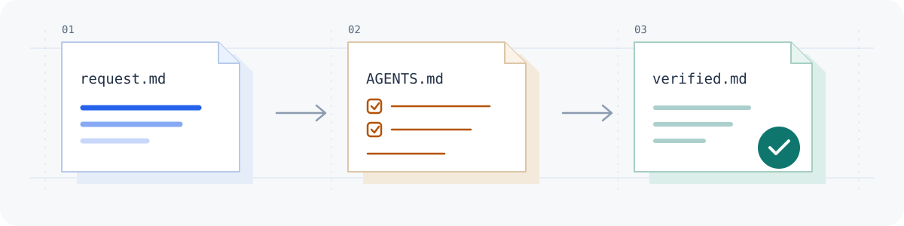

<!-- 영어 시작 안내를 제공하며 정식 운영 규칙과 응답 언어 정책은 기존 문서를 따른다. -->
<!-- Keep both READMEs in sync when changing prompts, scope, links, or limitations. -->

<h1 align="center">Agent-Instructions</h1>

<p align="center">
  <strong>Working instructions for coding agents.</strong><br>
  A shared process for understanding requests, making changes, and verifying results.
</p>

<p align="center">
  <a href="README.md">한국어</a> · <strong>English</strong>
</p>

<p align="center">
  <a href="https://github.com/nowJDev/Agent-Instructions/actions/workflows/ci.yml"></a>
  <a href="LICENSE"></a>
</p>

<picture>
  <source media="(prefers-color-scheme: dark)" srcset="assets/readme/hero-dark.svg">
  
</picture>

<p align="center">
  <a href="#getting-started">Get started</a> · <a href="#what-you-get">What you get</a> · <a href="#how-agents-work">Workflow</a> · <a href="#documentation-map">Documentation</a>
</p>

## Getting started

### Apply the instructions to an agent you already use

Send the following prompt to Codex, Claude Code, or another coding agent.

```text
Read this repository and apply it as my working instructions.
Read README.md first, then AGENTS.md and PORTABILITY.md.
Adapt Claude-specific features to equivalents in your environment; skip unsupported features.
This is a public operational guide and tool catalog, without tokens or personal configuration files.
https://github.com/nowJDev/Agent-Instructions
```

**Applying instructions means reading and following them.** Additional tools such as skills and MCP servers require a separate setup request. If the agent cannot open the link, download the repository and provide the files in the same order.

This README is available in English. Detailed operational guides are currently written in Korean. The default Korean response policy in `AGENTS.md` remains unchanged; specify a different response language separately if needed.

<a id="windows-setup"></a>
<details>
<summary><strong>Also prepare a Windows CLI and basic environment.</strong></summary>

A CLI is an agent tool that runs in a terminal. To prepare the CLI, basic instructions, and a desktop shortcut, use this prompt.

```text
Set up my environment following this repository.
https://github.com/nowJDev/Agent-Instructions
```

If you prefer a tool, add “Use Codex” or “Use Claude Code.” Only the selected client is prepared, preserving existing installations and personal instructions. Follow the [Windows getting-started guide (Korean)](GETTING_STARTED.md#41-windows-codex-환경-세팅) for scope and checks of execution, authentication, and instruction loading. Skills, MCP servers, and permission changes are not automatically included.

</details>

## What you get

Give agents that read files, make changes, and use tools a **working process and verification criteria**. They can find relevant guidance as needed instead of memorizing every document.

| Content | Purpose |
|---|---|
| **Operating rules.** | Clarify ambiguous requests, read existing material, and stay within the requested scope. |
| **Working process.** | Agree on changes, verify results, and report evidence and remaining checks. |
| **Skills and MCP catalog.** | Find working methods, external tools, their sources, and setup requirements. |
| **Portability guidance.** | Adapt Claude-specific features to supported equivalents in other agents, or skip them. |

Reading the documents does not automatically enforce every rule. Check which instructions the agent actually read and which results it verified.

## How agents work

**Understand the request → agree on the scope → implement and verify.**

For explanations and diagnostics without changes, the agent investigates and answers within the requested scope. Requests that change files go through scope and approach agreement, implementation, verification, and review. Unexpected results send the agent back to investigate the cause and revisit the relevant step.

Commit verified changes; merge, open pull requests, or push only within the authorized scope. See the [detailed workflow and examples (Korean)](GUIDE.md#ai에게-일을-맡긴-뒤-확인하는-방법).

### Using a different agent

Keep the principles of understanding the problem and verifying results. Adapt or omit tool names, configuration formats, and automatic blocking features according to what your agent actually supports. The [portability guide (Korean)](PORTABILITY.md) explains the differences between Claude Code, Codex, and other clients.

## Documentation map

**README introduces the project, AGENTS defines behavior, and GUIDE explains it for people.** Agents read `README.md`, then `AGENTS.md`, then `PORTABILITY.md` and the detailed documents relevant to the task.

The linked guides and catalogs below are in Korean.

| Looking for | Documentation |
|---|---|
| First use and environment setup. | [Getting started](GETTING_STARTED.md). |
| How to use the instructions and understand files and terms. | [Detailed guide](GUIDE.md). |
| Rules the agent should follow. | [Core rules](AGENTS.md), [verification](rules/01_enforcement-system.md), [tool boundaries](rules/02_tool-boundaries.md). |
| Adaptation for another agent. | [Portability](PORTABILITY.md). |
| Skills and external tools. | [Skill catalog](Skill/CATALOG.md), [sources and setup](Skill/README.md), [MCP guide](MCP/README.md). |
| Installable skills authored in this repository. | [Owned skills](Owned-Skills/README.md). |

A skill teaches an agent how to perform a task; MCP connects it to external tools. Consult [terms and file roles](GUIDE.md#문서와-도구는-어떻게-연결되나요), [feedback rules](rules/03_feedback-loop.md), [cleanup rules](rules/04_garbage-collection.md), and [automated checks](docs/ci.md) as needed. These documents are also in Korean.

## Frequently asked questions

<details>
<summary><strong>Are all listed tools installed automatically?</strong></summary>

The skills and MCP catalogs provide descriptions and sources. They are separate from your environment's installation, exposure, and authentication state. Set up only the tools you need from their original sources. Installable skills authored here are in `Owned-Skills/`.

</details>

<details>
<summary><strong>How do I know the agent read the instructions?</strong></summary>

Ask it to list the instruction files it actually read, summarize their core rules, and distinguish linked documents it has not read. After changing global instructions or a local copy, verify them in a new agent session. Updating GitHub does not update personal copies automatically.

</details>

<details>
<summary><strong>Does choosing English change the agent's response language?</strong></summary>

`README.en.md` provides an English overview. Detailed operational documents are currently in Korean, and choosing this README does not change the default Korean response policy in `AGENTS.md`. Specify the response language separately.

</details>

## License and notes

Documents, illustrations, and `Owned-Skills/` sources authored here use the [MIT license](LICENSE). Third-party tools and materials retain their authors' terms. This repository does not copy and redistribute third-party skill sources.

Keep tokens, authentication headers, personal settings, and internal project knowledge out of the public repository. See the [security policy (Korean)](SECURITY.md), [changelog (Korean)](CHANGELOG.md), and [work history (Korean)](docs/history/README.md).
