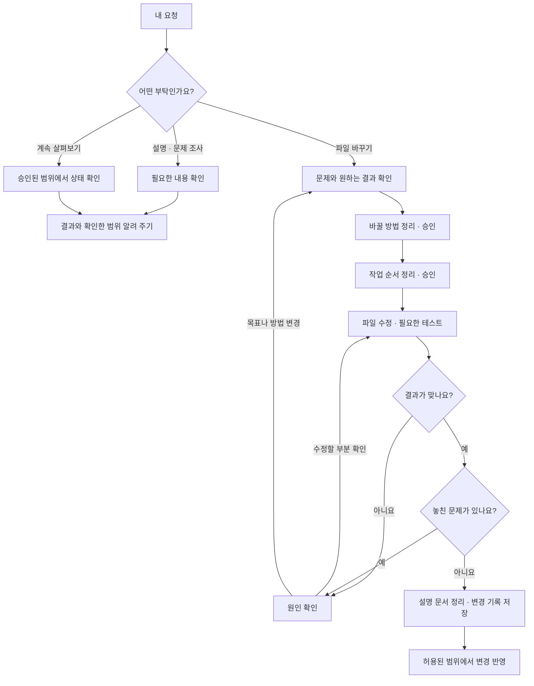
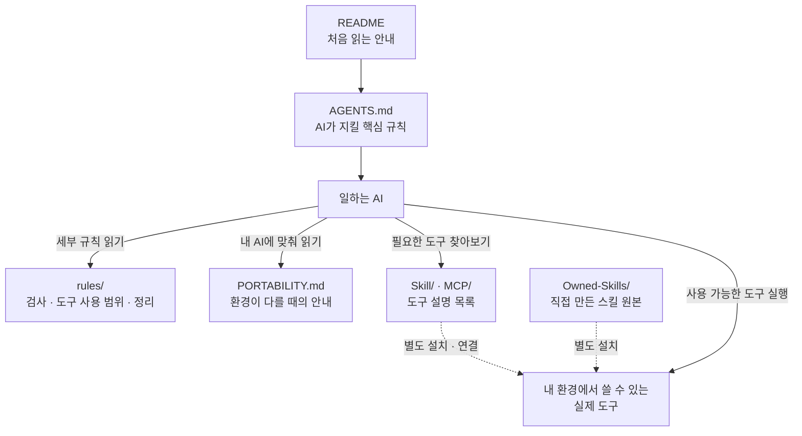

<!-- Encoding: UTF-8 (no BOM). 이 저장소의 모든 파일은 UTF-8이다. -->
<!-- 사람과 AI를 위한 시작 안내다. 정식 행동 규칙은 AGENTS.md와 rules/를 따른다. -->

# Agent-Instructions

**AI에게 일을 맡길 때, 먼저 읽게 하는 작업 안내서입니다.**

예를 들어 AI에게 “이 오류를 고쳐 줘”라고 부탁하면, 파일을 바꾸기 전에 문제를 확인하고, 고친 뒤에는 실제로 작동하는지 검사하도록 안내합니다. 사용자가 요청한 범위를 지키고, 비밀번호 같은 중요한 정보를 공개하지 않도록 하는 규칙도 담고 있습니다.

처음에는 **아래의 시작 문장 하나만 AI에게 보내면 됩니다.** 모든 문서를 읽거나 도구 이름을 외울 필요는 없습니다.

README는 사람과 AI가 함께 보는 시작 안내입니다. 사람은 [상세 사용 안내](GUIDE.md)에서 더 알아보고, AI는 [AGENTS.md](AGENTS.md)와 [PORTABILITY.md](PORTABILITY.md)를 읽은 뒤 작업에 필요한 `rules/` 등 상세 문서만 추가로 확인합니다.

[시작하기](#시작하기) · [AI가 일하는 순서](#ai가-일하는-순서) · [파일 역할 그림](#파일들은-어떤-역할을-하나요) · [쉬운 용어 설명](#낯선-말은-이렇게-읽으세요) · [필요한 문서 찾기](#더-알고-싶을-때-찾는-문서)

## 무엇에 쓰는 건가요

Codex나 Claude Code처럼 파일을 읽고 코드를 고치는 AI에게 **일하는 순서와 주의사항**을 알려 줍니다. 이런 AI를 이 문서에서는 “AI 에이전트”라고 부릅니다.

이 안내서를 읽은 AI는 다음 원칙을 따릅니다.

- 무엇을 바꿔야 할지 불분명하면 먼저 질문합니다.
- 파일을 고치기 전에 내용을 확인합니다.
- 요청한 부분을 고치고, 결과가 맞는지 검사합니다.
- 확인하지 못한 부분은 완료했다고 말하지 않고 알려 줍니다.

문서를 읽는 것만으로 모든 규칙이 자동으로 강제되는 것은 아닙니다. AI가 지침을 실제로 읽었는지, 결과를 검사했는지 확인해야 합니다. 자동으로 막거나 검사하는 기능은 사용하는 AI와 프로젝트의 설정에 따라 달라집니다.

## 시작하기

### 이미 쓰고 있는 AI에게 규칙을 알려 주려면

아래 내용을 복사해서 AI에게 보내세요. 여기서 “적용”은 **이 문서를 읽고 규칙을 따르라**는 뜻입니다.

```text
이 저장소를 읽고 내 작업 지침으로 적용해줘.
먼저 README.md를 읽고, 그 다음 AGENTS.md와 PORTABILITY.md를 읽어.
Claude 전용 기능은 네 환경의 동등 기능으로 번역하고, 없는 기능은 건너뛰어.
이 저장소는 토큰이나 개인 설정 파일을 포함하지 않는 공개용 운영 지침 카탈로그야.
https://github.com/nowJDev/Agent-Instructions
```

AI가 링크를 열 수 없다면 이 저장소를 내려받고, `README.md`, `AGENTS.md`, `PORTABILITY.md` 내용을 차례로 전달하세요. 읽은 규칙을 요약해 달라고 하면 적용 상태를 확인하는 데 도움이 됩니다.

### Windows에서 실행할 AI 도구까지 준비하려면

아래 내용을 AI에게 보내세요. 이 요청은 명령어를 입력하는 창에서 쓰는 AI 도구인 **CLI**와 기본 지침, 바탕화면 바로가기를 준비하도록 요청합니다.

```text
이거대로 세팅해줘.
https://github.com/nowJDev/Agent-Instructions
```

Codex 또는 Claude Code 중 원하는 것이 있으면 “Codex로 세팅해 줘”처럼 함께 말하세요. 선택한 하나만 준비하며, 이미 설치돼 있으면 재사용합니다.

| 선택한 도구 | 준비하는 것 |
|---|---|
| Codex | Codex CLI, 기존 내용을 보존한 기본 작업 지침, 공식 아이콘의 `Codex.lnk` 바로가기. |
| Claude Code | Claude Code CLI, 기존 내용을 보존한 기본 작업 지침 연결, 공식 아이콘의 `Claude Code.lnk` 바로가기. |

로그인이 필요하면 사용자가 직접 진행합니다. 준비가 끝났다는 보고에는 **실행·로그인·지침 읽기 확인 결과**가 있어야 합니다. 아직 확인하지 못한 항목은 미완료로 표시합니다.

기존 지침과 설정은 먼저 확인하고 보존합니다. 원하는 도구를 판단할 수 없으면 AI가 질문해야 합니다. 추가 스킬이나 외부 서비스 연결 등 확장 기능은 별도로 요청할 때 준비합니다.

설정 위치와 확인 방법은 [상세 사용 안내](GUIDE.md#규칙을-적용하고-실행-환경을-준비하는-방법)에 있습니다. **설치를 진행하는 AI는 [구체적인 설치 절차](GETTING_STARTED.md#41-windows-codex-환경-세팅)와 [바로가기 절차](references/windows-cli-shortcut.md)를 읽고 따라야 합니다.**

## AI가 일하는 순서

“설명해 줘”나 “문제점을 찾아 줘”라고 하면 조사해서 결과를 알려 줍니다. “고쳐 줘”처럼 파일을 바꾸는 요청은 무엇을 어떻게 바꿀지 정리한 뒤 작업하고 검사합니다.



예를 들어 “README를 쉽게 바꿔 줘”라고 하면, 내용을 고친 뒤 링크와 설명이 맞는지 확인합니다. 프로그램의 오류를 고칠 때는 그 오류를 보여 주는 테스트를 먼저 만들고, 수정 후 통과하는지 검사합니다.

마지막의 “변경 기록 저장”은 Git의 **커밋**을 뜻합니다. 다른 작업과 합치는 **병합**, 검토 요청인 **PR**, 온라인 저장소로 보내는 **푸시**는 요청·승인된 범위에서 진행합니다. 모든 작업에 이 과정이 필요한 것은 아닙니다. 자세한 순서는 [작업 절차 문서](Owned-Skills/design-driven-delivery/references/change-workflow.md)에 있습니다.

## 파일들은 어떤 역할을 하나요

이 저장소의 파일은 역할에 따라 나뉩니다. **README는 안내 지도, AGENTS.md는 AI가 지킬 규칙**입니다.



실선은 AI가 문서를 읽거나 도구를 사용하는 관계입니다. 점선은 별도 요청으로 설치·연결하는 관계입니다. 도구 설명이 이 저장소에 있다고 해서 내 컴퓨터에 그 도구가 설치된 것은 아닙니다. 그림을 지원하지 않는 뷰어에서는 그림 대신 코드가 보일 수 있으며, 앞뒤의 설명으로 내용을 확인할 수 있습니다.

AI는 `README.md` → `AGENTS.md` → 필요한 상세 문서 순서로 읽습니다. 다른 AI 환경에 맞추는 방법은 아래 안내를 따릅니다.

### 쓰는 AI가 다르면 어떻게 하나요

문제를 먼저 확인하고 결과를 검사하는 원칙은 그대로 따릅니다. 파일 읽기·검색·작업 위임처럼 방법이 다른 기능은 사용하는 AI의 기능으로 바꿔서 수행합니다.

Claude Code에만 있는 특정 도구나 자동 차단 기능이 다른 AI에도 있다고 가정하지 않습니다. 지원되지 않으면 사용 가능한 방법으로 대체하거나 제외하고, 자동 차단 기능이 없으면 AI가 해당 규칙을 직접 지켜야 합니다. 자세한 대체 방법은 [다른 AI에서 사용하는 안내](PORTABILITY.md)에 있습니다.

## 낯선 말은 이렇게 읽으세요

| 문서에 나오는 말 | 쉬운 뜻 |
|---|---|
| 저장소 | 문서와 코드를 모아 두는 곳입니다. 여기서는 이 GitHub 페이지의 파일 모음을 뜻합니다. |
| AI 에이전트 | 요청을 받아 파일을 읽거나 고치는 등 도구를 사용하는 AI입니다. |
| 클라이언트 | AI를 쓰기 위해 실행하는 앱이나 도구입니다. 여기서는 Codex, Claude Code 등을 뜻합니다. |
| CLI | 명령어를 입력하는 창에서 실행하는 프로그램입니다. |
| 스킬 / Skill | 특정 일을 할 때 AI가 읽는 작업 방법입니다. 예를 들어 코드 리뷰 방법을 안내합니다. |
| MCP | AI가 외부 도구나 서비스와 연결하는 방식입니다. 연결과 필요한 로그인은 따로 준비해야 합니다. |
| 카탈로그 | 사용할 수 있는 도구의 설명 목록입니다. 실제 설치 상태는 내 환경에서 확인합니다. |
| 검증 / 테스트 | 바꾼 결과가 맞고 제대로 작동하는지 확인하는 과정입니다. |
| 리뷰 | 검사 이후에도 놓친 문제나 잘못된 설명이 없는지 살펴보는 과정입니다. |

## 더 알고 싶을 때 찾는 문서

필요한 내용이 생겼을 때 해당 문서만 열어 보세요. 아래 상세 문서는 AI나 설치를 진행하는 사람이 참고할 수 있습니다.

| 알고 싶은 것 | 볼 문서 |
|---|---|
| 사용 방법과 도구의 역할을 더 자세히 이해하기. | [사람용 상세 사용 안내](GUIDE.md). |
| 처음 적용하는 방법과 설치 과정. | [시작 안내](GETTING_STARTED.md). |
| AI가 따라야 할 정확한 규칙. | [핵심 작업 규칙](AGENTS.md). |
| 결과 검사와 변경 기록 저장 기준. | [검증·커밋 규칙](rules/01_enforcement-system.md). |
| 도구로 무엇을 어디까지 할 수 있는지. | [도구 사용 범위](rules/02_tool-boundaries.md). |
| 반복되는 실수를 줄이는 방법. | [실수와 리뷰를 규칙에 반영하기](rules/03_feedback-loop.md). |
| 오래된 문서와 불필요한 내용을 정리하는 방법. | [문서·코드 정리 기준](rules/04_garbage-collection.md). |
| 원하는 작업에 쓸 스킬. | [스킬 전체 목록](Skill/CATALOG.md), [출처·설치 안내](Skill/README.md). |
| AI와 연결할 외부 도구. | [MCP 목록과 연결 안내](MCP/README.md). |
| 이 저장소에서 직접 만든 스킬. | [자체 제작 스킬 안내](Owned-Skills/README.md). |
| 다른 AI 환경에서 사용하는 방법. | [환경별 적용 안내](PORTABILITY.md). |
| 비밀번호 등 중요한 정보의 관리 기준. | [공개·보안 기준](SECURITY.md). |
| 저장소에서 바뀐 내용과 이용 조건. | [변경 이력](CHANGELOG.md), [라이선스](LICENSE). |

도구 목록은 작성 당시의 환경을 기준으로 합니다. 내 PC에서 사용할 수 있는 도구와 다를 수 있으므로 지원 여부·설치·인증 상태를 확인합니다. 타사 스킬은 각 원본의 설치 안내와 이용 조건을 따릅니다. 이 저장소가 직접 만든 스킬 원본은 `Owned-Skills/`에 있습니다.

토큰(서비스 접근용 비밀값)·인증 헤더·개인 설정 파일은 사용자 환경에서 관리하며 공개 저장소에 넣지 않습니다. 문서가 업데이트돼도 내 환경에 복사한 지침이 자동 갱신되지는 않습니다. 링크된 문서도 자동으로 모두 읽히는 것은 아닙니다. 지침을 바꾼 뒤에는 새 AI 세션에서 실제로 읽었는지 확인하세요.
