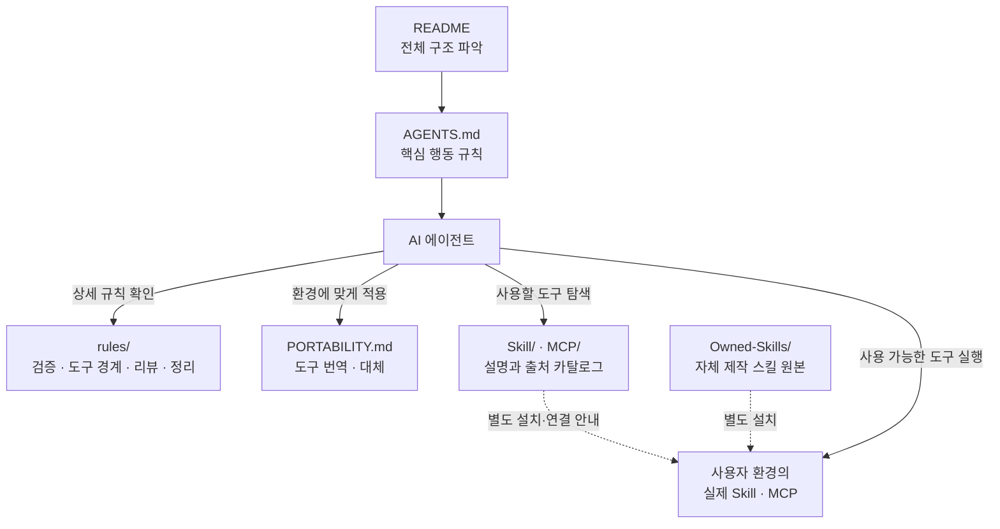
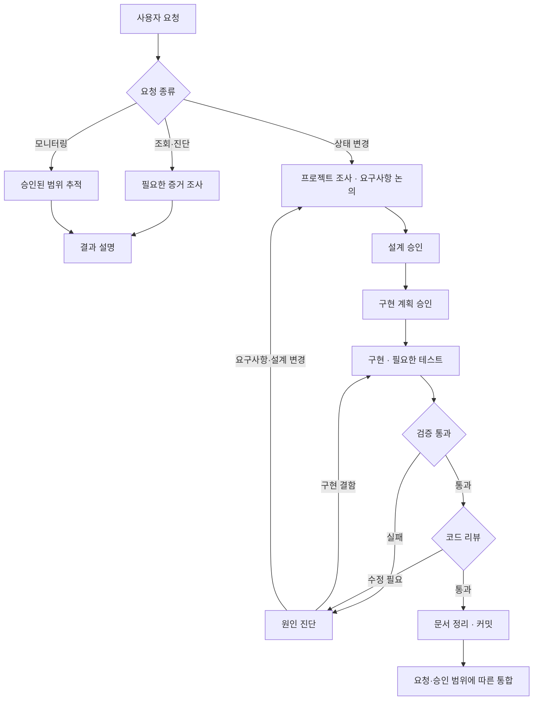

<!-- Encoding: UTF-8 (no BOM). 이 저장소의 모든 파일은 UTF-8이다. -->
<!-- 사람과 AI를 위한 안내 지도다. 정식 행동 규칙은 AGENTS.md와 rules/를 따른다. -->

# Agent-Instructions

> AI 코딩 에이전트의 작업 순서, 검증 규칙, 도구 선택 기준을 한곳에 정리한 운영 지침이다.

**의도 파악 → 설계·계획 승인 → 실행 → 검증·리뷰.** Claude Code와 Codex 등 각 에이전트 환경에 맞게 적용한다.

[적용 가이드](GETTING_STARTED.md) · [작동 구조](#작동-구조-한눈에) · [스킬 목록](Skill/CATALOG.md) · [MCP 목록](MCP/README.md) · [변경 이력](CHANGELOG.md)

## Quick Start

AI에게 다음 프롬프트를 전달한다.

```text
이 저장소를 읽고 내 작업 지침으로 적용해줘.
먼저 README.md를 읽고, 그 다음 AGENTS.md와 PORTABILITY.md를 읽어.
Claude 전용 기능은 네 환경의 동등 기능으로 번역하고, 없는 기능은 건너뛰어.
이 저장소는 토큰이나 개인 설정 파일을 포함하지 않는 공개용 운영 지침 카탈로그야.
https://github.com/nowJDev/Agent-Instructions
```

Windows에서 현재 클라이언트의 최소 CLI 환경을 세팅하려면 다음 공통 프롬프트를 전달한다.

```text
이거대로 세팅해줘.
https://github.com/nowJDev/Agent-Instructions
```

사용자가 지정한 대상을 우선하고, 미지정이면 신뢰할 수 있는 현재 세션의 실제 클라이언트 정보를 사용한다. 모델 이름이나 설치된 CLI 목록으로 추정하지 않으며 판별 불가면 한 번 질문한다. 두 CLI가 설치돼 있어도 선택한 하나만 처리한다. 선택한 CLI는 재사용하거나 없으면 공식 절차로 설치하고, 전역 기본 지침·공식 아이콘 바로가기·실행 확인과 필요한 사용자 로그인 안내까지 진행한다. 스킬·MCP·플러그인·hooks·테마·상태줄·권한 변경·bypass 옵션은 별도 확장 요청에서만 다룬다. 단순 "지침 적용"은 규칙을 읽고 따르는 의미다.

| 선택한 클라이언트 | 최소 세팅 결과 |
|---|---|
| Codex | Codex CLI, 기존 지침을 보존한 `~/.codex/AGENTS.md`, 공식 아이콘 `Codex.lnk` |
| Claude Code | Claude Code CLI, 기존 `~/.claude/CLAUDE.md`의 기본 지침 import, 공식 아이콘 `Claude Code.lnk` |

Windows Terminal은 있으면 재사용하고 없으면 CMD를 쓴다. 인증 대기·아이콘 준비 실패·실행 실패·지침 로드 미확인은 미완료로 보고한다.

| 사용 환경 | 다음 단계 |
|---|---|
| 처음 사용하는 경우 | [GETTING_STARTED.md](GETTING_STARTED.md)에서 적용 절차를 확인한다. |
| Codex 전역 적용 | [Codex 적용 안내](GETTING_STARTED.md#4-codex에서-헷갈리기-쉬운-부분)를 따른다. |
| Windows Codex·Claude Code 최소 세팅 | [환경 세팅 안내](GETTING_STARTED.md#41-windows-codex-환경-세팅)와 [공통 바로가기 절차](references/windows-cli-shortcut.md)를 따른다. |
| 다른 AI 환경 | [PORTABILITY.md](PORTABILITY.md)에서 도구 번역·대체 방법을 확인한다. |

> 행동 지침을 읽어 적용하고, 필요한 도구는 별도로 설치·연결한다. 토큰·인증 헤더·개인 설정은 각 사용자 환경에서 관리한다. 공개 기준은 [SECURITY.md](SECURITY.md)를 따른다.

## 작동 구조 한눈에

에이전트는 핵심 규칙을 따르고, 작업에 필요한 상세 지침과 도구 설명을 찾아 사용한다.



실선은 읽기·참조·실행 관계, 점선은 사용자가 별도로 수행하는 설치·연결 관계다. `Skill/`과 `MCP/`는 설명 문서이며, 자체 제작 스킬의 실행 원본은 `Owned-Skills/`에 있다.

## 0. 핵심 안내

- **핵심 지침.** `AGENTS.md`에서 시작하고, 필요한 상세 규칙만 `rules/`에서 읽는다.
- **도구 선택.** §6에서 작업에 맞는 문서를 찾고, §7~8에서 스킬·MCP 설명으로 이동한다.
- **환경 차이.** §5.5의 적용·번역·대체 기준을 따른다. 카탈로그는 작성 환경의 스냅샷이다.
- **규모.** 노출 스킬 **99개**와 OFF **22개**, 활성 MCP 서버 **10개**와 OFF **4개**를 설명한다.

## 1. 이 저장소는 무엇인가

작업마다 반복되는 의도 파악, 승인, 검증과 도구 선택을 문서로 정리한 패키지다. 규칙은 짧은 진입점에 두고, 세부 내용은 필요할 때 찾아 읽는다.

| 구성 | 역할 | 위치 |
|---|---|---|
| 행동 지침 | 에이전트가 따르는 작업 규칙과 경계다. | [AGENTS.md](AGENTS.md), [rules/](rules/) |
| 도구 카탈로그 | 스킬·MCP의 용도, 출처, 설치·연결 방법을 설명한다. | [Skill/](Skill/README.md), [MCP/](MCP/README.md), [references/](references/) |
| 자체 제작 원본 | 호환 클라이언트에 설치할 수 있는 직접 작성한 스킬이다. | [Owned-Skills/](Owned-Skills/README.md) |

실제 스킬·MCP를 사용하려면 해당 클라이언트의 지원 여부와 설치·인증 상태를 확인한다.

## 2. 읽기 순서 (AI 워크플로우)

### 문서 읽기

1. `README.md`로 전체 구조를 파악한다.
2. `AGENTS.md`로 핵심 행동 규칙을 읽는다.
3. 비-Claude 환경은 `PORTABILITY.md`로 도구와 용어를 번역한다.
4. 작업에 필요한 `rules/`, `Skill/`, `MCP/`의 개별 문서를 읽는다.

### 요청 처리

조회·진단·모니터링은 요청한 범위에서 수행한다. 상태 변경은 `design-driven-delivery`가 기존 전문 스킬을 사용해 다음 순서로 조율한다.



- 기능·버그 수정은 TDD를 적용하고, 문서·설정 변경은 변경 종류에 맞게 검증한다.
- 리뷰에서 동작 결함이 발견되면 구현으로 돌아가 관련 테스트와 검증을 다시 수행한다.
- 병합·PR·푸시는 요청·승인된 범위에서 수행한다. 모든 작업에 통합이 필요한 것은 아니다.
- 그림은 지침이 요구하는 절차를 요약한다. 자동 강제 여부는 사용하는 에이전트와 프로젝트의 훅·도구 구성에 따라 달라진다.

상세 절차는 [상태 변경 워크플로](Owned-Skills/design-driven-delivery/references/change-workflow.md)를 따른다.

## 3. 디렉토리 맵

핵심 규칙, 도구 카탈로그, 자체 제작 원본을 각각 분리해 관리한다.

<details>
<summary>전체 디렉터리 구조 보기</summary>

```
Agent-Instructions/
├─ README.md              ← 소개·작동 구조·도구 선택 지도
├─ AGENTS.md              ← 정식 행동 지침 진입점 (60줄, 매 작업 로드)
├─ GETTING_STARTED.md     ← 사람/AI용 빠른 적용 절차
├─ SECURITY.md            ← 공개·보안 기준
├─ CHANGELOG.md           ← 공개 저장소 변경 이력
├─ codex-global-AGENTS.md ← Codex 전역 ~/.codex/AGENTS.md용 지침
├─ LICENSE                ← 저장소 문서 라이선스
├─ index.html             ← 사람용 설명서 (AI는 무시해도 됨)
├─ PORTABILITY.md         ← 다른 AI(비-Claude)에서 스킬/MCP 쓰는 이식 가이드
├─ rules/                 ← 운영 체계 4대 축
│  ├─ 01_enforcement-system.md   검증·테스트·커밋 강제 / "성공은 조용히, 실패만 시끄럽게"
│  ├─ 02_tool-boundaries.md      RAG·서브에이전트·MCP 등록·팀·외부작업·Windows·Unity 도구 경계
│  ├─ 03_feedback-loop.md        리뷰→규칙 보강 반복, 규칙 추가·배치 기준
│  └─ 04_garbage-collection.md   문서-코드 정합·데드코드·MEMORY·Compact 청소
├─ Skill/                 ← 스킬 카탈로그 (스킬 1개당 md 1개)
│  ├─ README.md           스킬 분류 인덱스
│  ├─ _builtin/ (13)      Claude Code 내장 스킬
│  ├─ _personal/ (6)      개인 글로벌 스킬
│  ├─ _disabled/ (22)     OFF 플러그인 카탈로그(켜야 사용)
│  └─ <플러그인>/          활성 플러그인별 폴더
├─ Owned-Skills/          ← 직접 작성해 재배포할 수 있는 Agent Skill 실물 원본
│  └─ design-driven-delivery/
├─ MCP/                   ← MCP 카탈로그
│  ├─ README.md           MCP 인덱스
│  ├─ _disabled/ (4)      OFF MCP
│  ├─ claude-ai-PlayMCP/  PlayMCP 하위 5개 서버
│  └─ <server>.md         서버별 도구 표·연결방식
├─ docs/superpowers/plans/ ← 승인된 문서 정리 작업의 구현 계획
└─ references/            ← 보조 참조 문서(CLI 셋업, Windows 바로가기 등)
```

</details>

## 4. 핵심 개념

### 4.1 두 원칙

1. **짧은 진입점과 상세 문서.** `AGENTS.md`는 60줄 이하를 기준으로 관리하고, 상세 규칙은 별도 문서에 둔다.
2. **실패에서 규칙으로.** 반복되는 실수는 재발 방지 규칙으로 남긴다. 기록·배치 기준은 [피드백 루프](rules/03_feedback-loop.md)를 따른다.

### 4.2 4대 운영 축 (`rules/`)

| 축 | 규칙 | 역할 |
|---|---|---|
| 검증·커밋 | [rules/01](rules/01_enforcement-system.md) | 실행·테스트 근거를 확인한 뒤 완료·커밋한다. |
| 도구 경계 | [rules/02](rules/02_tool-boundaries.md) | 도구의 권한과 사용 범위를 정한다. |
| 피드백 루프 | [rules/03](rules/03_feedback-loop.md) | 리뷰와 실패에서 재발 방지 규칙을 만든다. |
| 정리 | [rules/04](rules/04_garbage-collection.md) | 문서 정합성, 데드 코드와 중복을 점검한다. |

## 5. 행동 규칙 요약 (정식 출처: `AGENTS.md`)

정식 규칙은 `AGENTS.md`와 `rules/`에서 확인한다. 사용자 지시와 해당 프로젝트 지침에 맞게 적용한다.

| 상황 | 따르는 규칙 |
|---|---|
| 의도·범위가 불명확함 | 추측으로 수정하지 않고 질문한다. |
| 파일을 수정하기 전 | 대상 파일을 처음부터 끝까지 읽는다. |
| 탐색·정보 조회 | 사용 가능한 RAG·서브에이전트·MCP를 확인한다. 라이브러리 문서는 `context7`을 우선한다. |
| 작업 진행 | 최대 3개 연속 액션 후 결과를 확인한다. |
| 예상과 다른 결과 | 멈추고 에러·로그를 끝까지 읽어 근본 원인을 확인한다. |
| 완료·커밋 전 | 적절한 실행·테스트·빌드·검색 검증을 수행한다. |
| 변경 범위 | 요청한 것만 최소 변경으로 해결한다. |
| 경로·공개 정보 | 상대경로·설정·환경변수를 쓰고, 토큰·인증 헤더·개인 설정을 커밋하지 않는다. |
| 삭제·원격 반영 | 파일은 개별 삭제하고 일반 push를 사용한다. |

Claude Code의 훅이나 특정 MCP가 다른 환경에도 있다고 가정하지 않는다. 해당 환경에 없는 안전장치는 수동 규율과 지원되는 도구로 보완한다.

## 5.5 적용 범위 — 범용 코어 vs Claude 전용 ⭐ (비-Claude AI 필독)

| 분류 | 대상 | 적용 방법 |
|---|---|---|
| 그대로 적용 | 의도 파악·승인·검증, 보안, 디버깅, 정리, 출력 규칙 | 행동 규칙으로 따른다. |
| 환경에 맞게 번역 | 파일 읽기·검색, 서브에이전트, 스킬 호출, MCP 등록 | 해당 AI의 동등 기능과 설정 방식을 사용한다. |
| 지원 여부 확인 후 대체·제외 | 특정 RAG, 훅, Team·모니터, MEMORY·Compact, Claude 설정 동기화 | 기능·서버가 없으면 대체하고 Claude 전용 설치 절차는 제외한다. |

> `rules/02 §6`의 `claude mcp add` 사용 규칙은 Claude Code 한정이다. 다른 AI는 자기 클라이언트의 설정 방식을 따른다. `team-monitor`와 `dotfiles/sync.py`도 Claude 환경의 절차다.

세부 번역표와 설치·인증·라이선스 기준은 [PORTABILITY.md](PORTABILITY.md)를 따른다. `claude.ai PlayMCP`는 계정 연동에 종속되므로 다른 AI에서는 대체 서버나 API가 필요하다.

<details>
<summary>Claude 전용 용어 설명 보기</summary>

### 용어 빠른 정의 (Claude 전용 — 외부 AI가 모를 수 있음)
- **`rag_agent`** — 이 사용자 환경의 rag-search MCP 도구(코드 RAG 검색). 외부 AI엔 없음 → 자체 검색/임베딩으로 대체.
- **`Task`/`Explore`** — Claude Code의 서브에이전트(탐색 위임) 메커니즘 → 그 AI의 서브에이전트로.
- **`PreToolUse 훅`** — 도구 실행 전 가로채 차단하는 Claude Code settings.json 기능(rm -rf·시크릿 차단). 외부 AI엔 없음 → 수동 준수.
- **`Skill` 도구** — SKILL.md를 트리거·로드하는 Claude Code 기능 → §PORTABILITY 경로 A/B/C.
- **`MEMORY.md`/`Compact`** — 자동 메모리 파일 / 컨텍스트 압축. Claude Code 하네스 기능 → 동등물 있으면 매핑, 없으면 제외.

</details>

## 6. 의사결정 가이드 (WHEN → WHERE)

| 하려는 것 | 확인할 문서 |
|---|---|
| 행동 규칙 확인 | [AGENTS.md](AGENTS.md) |
| 검증·테스트·커밋 | [rules/01](rules/01_enforcement-system.md) |
| 도구 권한·외부 작업 범위 | [rules/02](rules/02_tool-boundaries.md) |
| 어떤 스킬을 쓸지 | §7, [Skill/README.md](Skill/README.md) |
| 특정 스킬의 트리거·사용법·출처 | [Skill/CATALOG.md](Skill/CATALOG.md)에서 개별 문서로 이동한다. |
| 자체 제작 스킬 설치 | [Owned-Skills/README.md](Owned-Skills/README.md) |
| 어떤 MCP를 쓸지 | §8, [MCP/README.md](MCP/README.md) |
| 규칙 추가·피드백 기록 | [rules/03](rules/03_feedback-loop.md) |
| 기존 지침 보완·추가 도구 검토 | [공개 저장소 선별 반영](references/starred-repo-adoption.md)에서 채택 근거·기존 중복·필요 상황을 확인한다. |
| 정리·문서 정합성 확인 | [rules/04](rules/04_garbage-collection.md) |
| CLI 설치·Windows 바로가기 | [references/](references/) |
| 다른 AI 환경에서 적용 | [PORTABILITY.md](PORTABILITY.md) |

## 7. 스킬 카탈로그 전체 인덱스 (노출 99)

노출 **99개**, OFF **22개**의 설명 문서를 제공한다. 전체 분류·출처는 [스킬 인덱스](Skill/README.md), 한 줄 설명은 [스킬 목차](Skill/CATALOG.md)에서 확인한다.

| 작업 | 우선 확인할 스킬·도구 |
|---|---|
| 상태 변경 전체 | `design-driven-delivery` |
| 설계·계획 | `brainstorming` → `writing-plans` |
| 기능·버그 구현 | `test-driven-development`, `systematic-debugging` |
| 검증·리뷰 | `verification-before-completion`, `verify`, `code-review`, `simplify` |
| 웹·리서치·라이브러리 문서 | `firecrawl-*`, `deep-research`, `context7` MCP |

사용 가능한 항목은 실제 설치 환경에서 확인한다. Codex 전역 스킬은 `~/.agents/skills`에 설치된 항목을 기준으로 사용한다.

<details>
<summary>그룹별 전체 스킬 목록 보기</summary>

### _builtin (13) — Claude Code 내장
`code-review` · `simplify` · `verify` · `run` · `loop` · `schedule` · `update-config` · `keybindings-help` · `fewer-permission-prompts` · `claude-api` · `init` · `review` · `security-review`

### _personal (6) — 개인 글로벌
`claude-news` · `delete-session` · `handover` · `deep-research` · `hexagonal-code-review` · `design-driven-delivery`

### superpowers (14) — 개발 워크플로우 방법론
`brainstorming` · `writing-plans` · `test-driven-development` · `systematic-debugging` · `executing-plans` · `subagent-driven-development` · `dispatching-parallel-agents` · `requesting-code-review` · `receiving-code-review` · `finishing-a-development-branch` · `using-git-worktrees` · `verification-before-completion` · `writing-skills` · `using-superpowers`

### huggingface-skills (18) — HF Hub·모델·Spaces
`hf-cli` · `huggingface-best` · `huggingface-community-evals` · `huggingface-datasets` · `huggingface-gradio` · `huggingface-llm-trainer` · `huggingface-local-models` · `huggingface-lora-space-builder` · `huggingface-paper-publisher` · `huggingface-papers` · `huggingface-spaces` · `huggingface-tool-builder` · `huggingface-trackio` · `huggingface-vision-trainer` · `huggingface-zerogpu` · `train-sentence-transformers` · `transformers-js` · `trl-training`

### firecrawl (11) — 웹 스크래핑·검색·크롤
`firecrawl-scrape` · `firecrawl-search` · `firecrawl-crawl` · `firecrawl-map` · `firecrawl-download` · `firecrawl-interact` · `firecrawl-monitor` · `firecrawl-parse` · `firecrawl-agent` · `firecrawl-cli` · `skill-gen`

### figma (9) — 디자인·다이어그램
`figma-use` · `figma-use-figjam` · `figma-use-slides` · `figma-generate-design` · `figma-generate-diagram` · `figma-generate-library` · `figma-create-new-file` · `figma-code-connect` · `figma-generate-project-plan`

### plugin-dev (8) — Claude Code 플러그인 개발
`create-plugin` · `plugin-structure` · `agent-development` · `command-development` · `hook-development` · `mcp-integration` · `plugin-settings` · `skill-development`

### chrome-devtools-mcp (6) — 브라우저 디버깅·성능
`chrome-devtools` · `chrome-devtools-cli` · `a11y-debugging` · `debug-optimize-lcp` · `memory-leak-debugging` · `troubleshooting`

### ralph-loop (3) · claude-md-management (2) · qodo-skills (2)
`ralph-loop` · `cancel-ralph` · `help` ‖ `revise-claude-md` · `claude-md-improver` ‖ `qodo-get-rules` · `qodo-pr-resolver`

### 단일 스킬 플러그인 (7)
`agent-sdk-dev/new-sdk-app` · `pr-review-toolkit/review-pr` · `feature-dev/feature-dev` · `claude-code-setup/claude-automation-recommender` · `skill-creator/skill-creator` · `frontend-design/frontend-design` · `playground/playground`

### ⛔ OFF (`_disabled/`, 22) — 켜야 사용
`vercel`(스킬7+커맨드6) · `hookify`(5) · `neon`(2, ⚠️원문 미vendoring·메타데이터 기반) · `railway`(1) · `semgrep`(1)

> 각 스킬 md는 동일한 5항목: **용도 / 트리거 / 사용예시·명령어 / 제공도구·파라미터 / 출처·설치상태**. 전체 인덱스는 [`Skill/README.md`](Skill/README.md).

</details>

## 8. MCP 카탈로그 인덱스

활성 서버 **10개**와 OFF 서버 **4개**를 설명한다. 연결 방식·도구·인증 안내는 [MCP/README.md](MCP/README.md)에서 확인한다.

### 활성 (ON)

| 서버 | 용도 | 사용 조건·경계 |
|---|---|---|
| [notion](MCP/notion.md) | Notion 페이지·DB 조회 | 사용자 인증이 필요하며 수정 경계는 `rules/02`를 따른다. |
| [context7](MCP/context7.md) | 라이브러리·프레임워크 공식 문서 | 라이브러리 질문 시 우선 확인한다. |
| [playwright](MCP/playwright.md) | 브라우저 자동화·E2E·스크린샷 | 등록된 서버의 사용 가능한 도구를 확인한다. |
| [figma](MCP/figma.md) | 디자인·다이어그램 연동 | OAuth 인증과 클라이언트 지원이 필요하다. |
| [huggingface-skills](MCP/huggingface-skills.md) | HF Hub·모델·작업 | OAuth 인증과 클라이언트 지원이 필요하다. |
| [claude.ai PlayMCP](MCP/claude-ai-PlayMCP/README.md) | 네이버·사람인·미국주식·DART·카카오 | 계정에 연동된 5개 하위 서버로 구성된다. |

### ⛔ OFF (`MCP/_disabled/`, 4)

`vercel` · `railway` · `neon` · `semgrep`은 작성 환경에서 비활성 상태다. 설명은 [MCP/_disabled/](MCP/_disabled/)에 있다.

## 9. 메타 · 정합성 · 알려진 한계

- 카탈로그는 작성 환경의 스냅샷이다. 다른 PC·에이전트에서 설치 상태와 노출 수가 달라질 수 있다.
- 스킬 설명 121개와 MCP 문서 15개를 제공한다. 활성 MCP 문서 11개에는 PlayMCP 묶음 안내 1개가 포함되어 실제 활성 서버는 10개다.
- 타사 스킬은 출처와 설치 방법을 안내한다. 직접 작성한 원본만 `Owned-Skills/`에서 재배포한다. [라이선스](LICENSE)와 [보안 기준](SECURITY.md)을 확인한다.
- Mermaid를 지원하지 않는 뷰어에서는 그림이 소스로 표시될 수 있다. 각 그림 앞뒤의 설명으로 구조와 흐름을 확인할 수 있다.

<details>
<summary>작성 환경과 카탈로그의 상세 주의사항 보기</summary>

- **비노출 ON 플러그인(의도된 제외, 누락 아님)**: `atomic-agents`, LSP 4종(`rust-analyzer`·`typescript`·`pyright`·`csharp`). ON이지만 스킬/MCP로 노출 안 됨 → 카탈로그에 없는 게 정상.
- **동명 주의**: 빌트인 `simplify`·`code-review`는 플러그인 `code-simplifier`·`pr-review-toolkit`(agent/command 제공)과 **별개**.
- **카탈로그 = 스냅샷**: 스킬/MCP 목록은 작성 환경 기준. 다른 환경에선 다를 수 있다 → 변경 시 `rules/04`(GC)에 따라 `Skill/`·`MCP/`와 README 숫자를 함께 갱신.
- **figma 9 vs 노출 8**: 카탈로그는 figma 9개(`generate-project-plan` 포함)다. 단 `generate-project-plan`은 캐시 `workflow-skills/` 소속이라 환경에 따라 **세션 노출이 8개일 수 있다**(카탈로그 자체는 자기일관적).
- **neon 문서 성격**: `_disabled/neon/` 2개는 원본 `SKILL.md`가 깨진 심볼릭 링크라 **원문 대신 매니페스트 메타데이터로** 작성됨(문서 자체는 완결, "파일 없음"이 아님). 원문은 `github.com/neondatabase/agent-skills`에서 받는다.
- **확장 가이드의 외부 전제**: [Claude Code 확장 가이드](references/claude-code-cli-setup.md)의 추가 설정은 형제 저장소(`claude-code-cli-settings`)의 `dotfiles/`·`mcp-servers/`를 전제하며 **이 저장소엔 그 실물이 없다**. 명시적 확장 요청 때만 사용하고 기본 세팅은 [GETTING_STARTED.md](GETTING_STARTED.md)를 따른다.
- **Windows CLI 바로가기**: [공통 바로가기 절차](references/windows-cli-shortcut.md)는 선택한 Codex·Claude Code의 공식 아이콘 `.lnk`를 생성·갱신·검증한다. 실제 바탕화면 경로를 사용해 OneDrive 리디렉션을 지원한다. 아이콘 바이너리는 저장소에 포함하지 않고 선택한 사용자 전역 `assets/icons/`에 둔다. [기존 Codex 문서 주소](references/codex-windows-shortcut.md)는 공통 절차로 연결한다.
- **출처 근거**: 각 스킬/MCP 문서는 플러그인 캐시의 실제 `SKILL.md`·`.mcp.json`을 근거로 작성됨(추측 아님). 캐시 절대경로 표기는 작성 환경 기준.

</details>

---

카탈로그 기준일 **2026-07-29** · README 정리 **2026-10-12** · [사람용 상세 안내](index.html) · [변경 이력](CHANGELOG.md)
