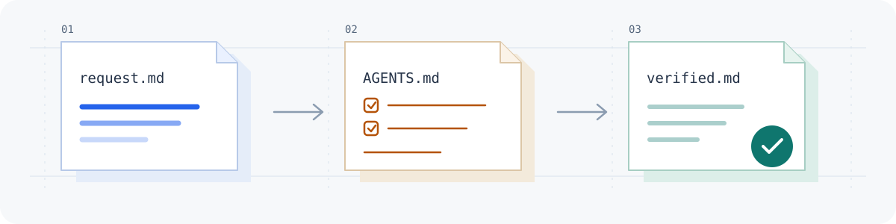

<!-- Encoding: UTF-8 (no BOM). 이 저장소의 모든 파일은 UTF-8이다. -->
<!-- 사람과 AI를 위한 시작 안내이며 정식 행동 규칙은 AGENTS.md와 rules/를 따른다. -->

<h1 align="center">Agent-Instructions</h1>

<p align="center">
  <strong>AI가 작업 전에 읽는 운영 지침.</strong><br>
  요청 확인부터 결과 검증까지, 일하는 기준을 정리했습니다.
</p>

<p align="center">
  <strong>한국어</strong> · <a href="README.en.md">English</a>
</p>

<p align="center">
  <a href="https://github.com/nowJDev/Agent-Instructions/actions/workflows/ci.yml"></a>
  <a href="LICENSE"></a>
</p>

<picture>
  <source media="(prefers-color-scheme: dark)" srcset="assets/readme/hero-dark.svg">
  
</picture>

<p align="center">
  <a href="#시작하기">시작하기</a> · <a href="#제공하는-내용">제공 내용</a> · <a href="#ai가-일하는-순서">작업 흐름</a> · <a href="#문서-지도">문서 지도</a>
</p>

## 시작하기

### 이미 쓰고 있는 AI에게 규칙을 알려 주려면

Codex나 Claude Code 등 사용 중인 AI에게 아래 문장을 전달하세요.

```text
이 저장소를 읽고 내 작업 지침으로 적용해줘.
먼저 README.md를 읽고, 그 다음 AGENTS.md와 PORTABILITY.md를 읽어.
Claude 전용 기능은 네 환경의 동등 기능으로 번역하고, 없는 기능은 건너뛰어.
이 저장소는 토큰이나 개인 설정 파일을 포함하지 않는 공개용 운영 지침 카탈로그야.
https://github.com/nowJDev/Agent-Instructions
```

**적용은 문서를 읽고 규칙을 따르는 것입니다.** 스킬·MCP 등의 추가 도구는 별도 요청으로 준비합니다. 링크를 읽을 수 없다면 저장소를 내려받고 위 순서로 파일 내용을 전달하세요.

<a id="windows에서-실행할-ai-도구까지-준비하려면"></a>
<details>
<summary><strong>Windows CLI와 기본 환경도 준비하기.</strong></summary>

CLI는 명령어 창에서 실행하는 AI 도구입니다. CLI와 기본 지침, 바탕화면 바로가기까지 준비하려면 다음 문장을 사용하세요.

```text
이거대로 세팅해줘.
https://github.com/nowJDev/Agent-Instructions
```

원하는 도구가 있으면 “Codex로 세팅해 줘” 또는 “Claude Code로 세팅해 줘”라고 덧붙이세요. 선택한 하나만 준비하고 기존 설치와 개인 지침을 보존합니다. 기본 범위와 실행·인증·지침 로드 확인은 [Windows 시작 안내](GETTING_STARTED.md#41-windows-codex-환경-세팅)를 따릅니다. 스킬·MCP·권한 변경은 기본 세팅에 자동 포함하지 않습니다.

</details>

<a id="무엇에-쓰는-건가요"></a>
## 제공하는 내용

파일을 읽고 고치며 도구를 사용하는 AI에게 **작업 순서와 확인 기준**을 알려 줍니다. 모든 문서를 외울 필요 없이 필요한 안내를 찾아 읽도록 구성했습니다.

| 내용 | 하는 일 |
|---|---|
| **운영 규칙.** | 불명확한 요청을 확인하고, 기존 내용을 읽은 뒤 요청 범위 안에서 작업합니다. |
| **작업 절차.** | 변경 범위를 합의하고 결과를 검사하며, 확인한 근거와 남은 사항을 보고합니다. |
| **스킬과 MCP 안내.** | 작업 방법과 외부 도구의 용도·출처·설치 조건을 찾습니다. |
| **환경별 적용.** | Claude 전용 기능을 다른 AI의 지원 기능으로 바꾸거나 제외합니다. |

문서를 읽는 것만으로 모든 규칙이 자동 강제되지는 않습니다. 실제로 읽은 지침과 검사한 결과를 확인해야 합니다.

## AI가 일하는 순서

**의도 확인 → 변경 범위 합의 → 실행과 검증.**

“설명해 줘”나 수정 없는 진단은 요청한 범위에서 조사하고 답합니다. “고쳐 줘”처럼 파일을 바꾸는 작업은 범위와 방법을 정한 뒤 수정·검사·리뷰합니다. 예상과 다른 결과가 나오면 원인을 확인하고 필요한 단계로 돌아갑니다.

검증한 변경을 커밋하고, 병합·PR·푸시는 승인된 범위에서 진행합니다. 자세한 흐름과 예시는 [상세 사용 안내](GUIDE.md#ai에게-일을-맡긴-뒤-확인하는-방법)에 있습니다.

### 쓰는 AI가 다르면 어떻게 하나요

문제를 확인하고 결과를 검사하는 원칙은 유지합니다. 도구명·설정 형식·자동 차단 기능은 사용하는 AI가 실제로 지원하는 방식으로 바꾸거나 제외합니다. [환경별 적용 안내](PORTABILITY.md)에서 Claude Code·Codex·다른 클라이언트의 차이를 확인하세요.

<a id="파일들은-어떤-역할을-하나요"></a>
<a id="더-알고-싶을-때-찾는-문서"></a>
## 문서 지도

**README는 시작 안내, AGENTS는 행동 규칙, GUIDE는 사람용 상세 설명입니다.** AI는 `README.md` → `AGENTS.md` → `PORTABILITY.md`와 해당 작업에 필요한 상세 문서 순서로 읽습니다.

| 찾는 내용 | 문서 |
|---|---|
| 처음 적용하고 실행 환경 준비하기. | [시작 안내](GETTING_STARTED.md). |
| 사용 방법과 파일·용어의 역할 이해하기. | [상세 사용 안내](GUIDE.md). |
| AI가 따라야 할 작업 규칙 확인하기. | [핵심 규칙](AGENTS.md), [검증](rules/01_enforcement-system.md), [도구 경계](rules/02_tool-boundaries.md). |
| 다른 AI 환경에 맞게 적용하기. | [환경별 적용](PORTABILITY.md). |
| 엑셀·PPT 등 분야에서 전체 스킬 찾고 고르기. | [분야별 전체 목록·빠른 선택](Skill/BY-TASK.md). |
| 전체 스킬과 외부 도구의 출처·설치 조건 찾기. | [스킬 목록](Skill/CATALOG.md), [출처·설치 안내](Skill/README.md), [MCP 안내](MCP/README.md). |
| 문서·디자인·Unity 작업의 도구와 실행 조건 확인하기. | [Anthropic 스킬](Skill/anthropic-skills/README.md), [Office·디자인 도구](Skill/office-design-tools/README.md), [Unity 연결](MCP/coplay-funplay-unity-mcp.md). |
| 이 저장소에서 직접 만든 스킬 사용하기. | [자체 제작 스킬](Owned-Skills/README.md). |

<a id="낯선-말은-이렇게-읽으세요"></a>
스킬은 AI가 특정 일을 수행하는 방법이고, MCP는 AI와 외부 도구를 연결하는 방식입니다. [용어와 파일 역할](GUIDE.md#문서와-도구는-어떻게-연결되나요), [피드백 규칙](rules/03_feedback-loop.md), [정리 규칙](rules/04_garbage-collection.md), [자동 검사 안내](docs/ci.md)는 필요할 때 확인하세요.

## 자주 묻는 질문

<details>
<summary><strong>목록에 있는 도구가 모두 설치되나요.</strong></summary>

스킬·MCP 카탈로그는 설명과 출처입니다. 현재 환경의 설치·노출·인증 상태와 구분하며, 필요한 도구만 각 원본에서 별도로 준비합니다. 직접 만든 스킬의 설치 가능한 원본은 `Owned-Skills/`에 있습니다.

[분야별 목록](Skill/BY-TASK.md)은 대표 도구뿐 아니라 등록된 설명·원본 주소 전체를 연결합니다. [날짜별 전수조사](references/skill-inventory-2026-11-12.json)는 직접 설치·시스템·현재 제공 플러그인의 항목과 등록·제외 사유를 대조합니다. 같은 이름의 다른 구현과 직접 비노출 전문 가이드를 구분하므로 목록의 행 수가 현재 호출 가능한 스킬 수는 아닙니다.

</details>

<details>
<summary><strong>AI가 지침을 읽었는지 어떻게 확인하나요.</strong></summary>

“실제로 읽은 지침 파일을 나열하고 핵심 규칙을 요약해 줘. 링크된 문서도 읽었는지 구분해 줘”라고 요청하세요. 전역 지침이나 로컬 복제본을 변경했다면 새 AI 세션에서 확인합니다. GitHub 업데이트만으로 개인 환경의 복제본이 갱신되지는 않습니다.

원본 작업 폴더를 삭제해도 사용하려면 전역 복제본에 필요한 문서·리소스를 **독립된 실제 파일로 복사**하고, 전역 진입점은 그 복제본을 가리키게 합니다. 갱신 전 기존 전역 문서와 개인 자료를 복제본 밖에 백업하고, 복사 후 파일 목록·해시·내부 링크를 확인합니다. 설치된 스킬과 실행 도구는 별도로 관리합니다.

</details>

<details>
<summary><strong>영어 안내를 선택하면 AI도 영어로 답하나요.</strong></summary>

`README.en.md`는 영어 시작 안내입니다. 상세 운영 문서는 현재 한국어이며, 영어 README를 선택해도 `AGENTS.md`의 한국어 응답 정책은 바뀌지 않습니다. 응답 언어는 별도로 지정해야 합니다.

</details>

## 라이선스와 참고 사항

직접 작성한 문서·그림과 `Owned-Skills/` 원본은 [MIT 라이선스](LICENSE)를 따릅니다. 타사 도구와 자료에는 각 제작사의 조건이 적용되며, 타사 스킬 원본을 이 저장소에 복사해 재배포하지 않습니다.

토큰·인증 헤더·개인 설정과 내부 프로젝트 지식은 공개 저장소에 넣지 않습니다. [보안 기준](SECURITY.md), [변경 이력](CHANGELOG.md), [작업 기록](docs/history/README.md)에서 자세히 확인하세요.
